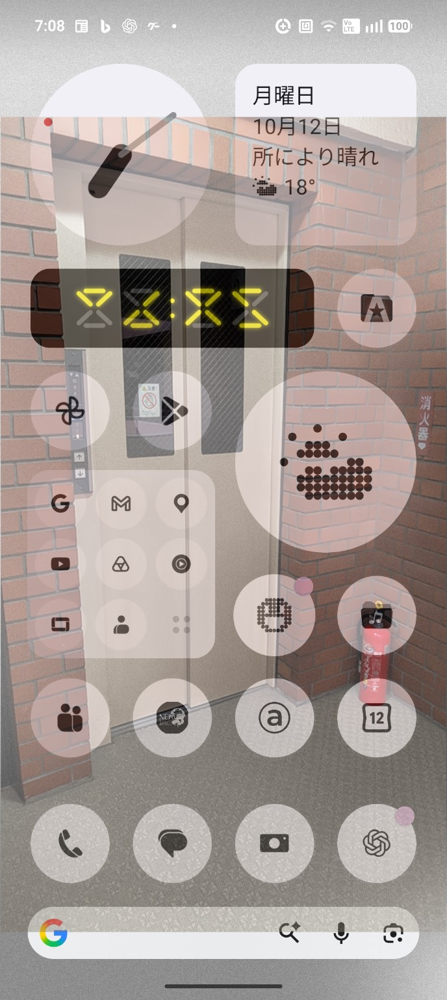

# HOLE — Transparent Phone

**The screen becomes a window.**

HOLE is an experimental Android app that displays the rear camera as a translucent overlay above other apps. At its default 50% opacity, the image of the world behind the phone and the app beneath are visually superimposed. A manual optical calibration adjusts camera scale and X/Y offsets to approximate alignment with the real scene.

> **Status:** P0.1 prototype. The author confirmed installation and basic operation on Nothing Phone (2) on September 19, 2026. This package preserves the original app Java code and adds publication materials / CI only. The release produced through GitHub Actions is a **debug-signed test APK**, not a production-signed store release.

## Actual device screenshot

HOLE running on the Nothing Phone (2): the Android home screen is layered over the live image from the rear camera. This is a **real device screenshot**, not a mockup.



More device screenshots or video can be captured using `bash scripts/capture-screen.sh [filename]`.

## Features

- Rear-camera image layered over other apps
- 50% default mixing mode, 10–79% touch-through opacity slider
- 100% HOLE VIEW mode for optical viewing, **not** touch-through on Android 12+
- Manual SCALE / X OFFSET / Y OFFSET calibration (single saved calibration)
- Foreground camera service and STOP action in the persistent notification
- No Internet permission, video recording, still-image saving, or analytics
- Android 8+; project builds with SDK 35 and Java 17

## Install APK

1. Open [GitHub Releases](https://github.com/Masato-Nasu/HOLE/releases) after publication.
2. Download `HOLE-v0.1.0-debug.apk` and install it on Android.
3. Grant CAMERA, overlay permission, and notification permission if requested.
4. Choose `CALIBRATE` to align the scene, then select `50%` or a 10–79% camera layer.
5. Tap `START TRANSPARENT PHONE`. Use another app beneath it. Tap `STOP` from the notification to end.

**Caution:** Debug-signed APKs from separate GitHub Actions runs may use different signing certificates. Installing a newer build over an older one may fail; backup your calibration or uninstall the previous build if necessary (uninstalling erases app settings). No proprietary Android app store or signed production release is claimed.

## How to build

Open this project in Android Studio (JDK 17, SDK 35), or run:

```sh
./verify-project.sh
./gradlew assembleDebug
```

APK: `app/build/outputs/apk/debug/app-debug.apk`. The Gradle wrapper launcher included in the original prototype bootstraps its wrapper JAR on first run; GitHub Actions instead installs Gradle 8.11.1 via `gradle/actions/setup-gradle`.

## GitHub publication

See [`PUBLISH.md`](PUBLISH.md). On pushes to `main`, GitHub Actions builds an APK for manual download from the **Actions** tab. On a `v*` tag, the workflow also creates a GitHub **Release** with that APK, if the build succeeds.

## What it is — and isn't

HOLE simulates a see-through display. It does **not** make the phone's hardware transparent. Camera optical offset, lens distortion, field of view and parallax prevent a perfect alignment at every viewing distance. Android blocks or restricts overlays on some security-sensitive screens, and may display a camera-in-use privacy indicator.

## Privacy / permissions

HOLE uses the live rear camera preview, overlay permission, camera foreground-service permission and notification capabilities. No Internet permission is requested. The app does not store or transmit camera frames. For details, inspect `app/src/main/AndroidManifest.xml`.

## 日本語

**HOLEは、スマートフォンの画面を「向こう側が見える穴」に見せるAndroidアプリです。** 背面カメラのライブ映像をほかのアプリの上に半透明で重ね、画面を触った操作は下のアプリへ通します。標準50%、タッチ透過は10〜79%、100%は鑑賞専用です。倍率・X/Y位置を手動調整できます。Android 12以降のセキュリティ制限により、100%では下のアプリを操作できません。完全な透明ディスプレイではなく、カメラと画面を使った視覚的な錯覚です。

詳細・公開手順：[`PUBLISH.md`](PUBLISH.md)。元の動作版README：[`README-ORIGINAL.md`](README-ORIGINAL.md)。

**Creator:** Masato Nasu / MASATO LAB — https://masato-lab.pages.dev/
